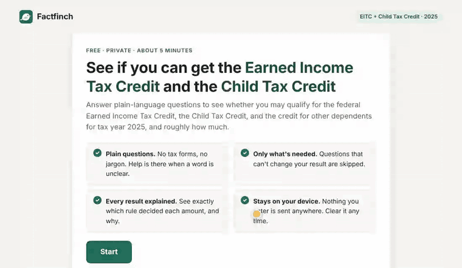
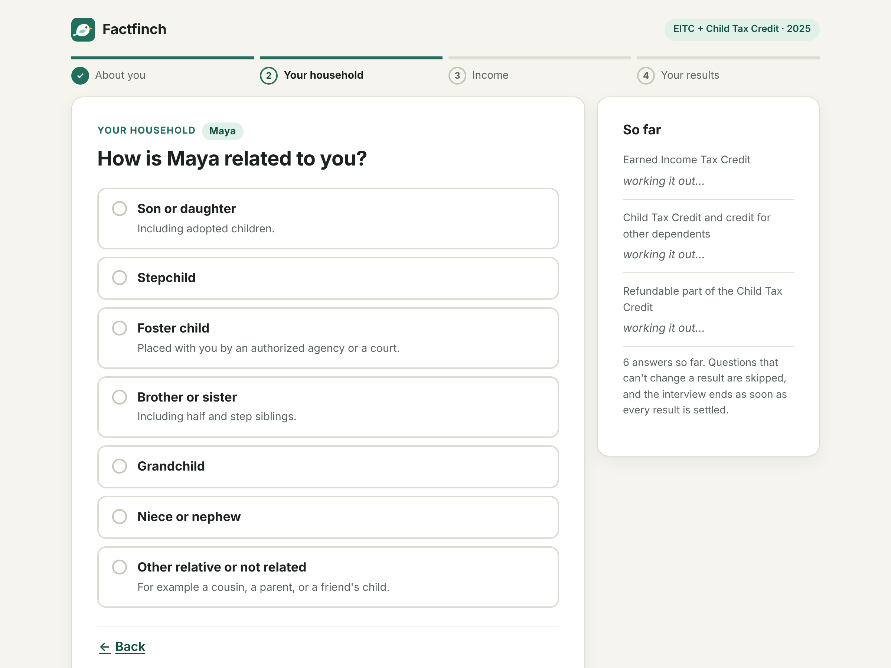
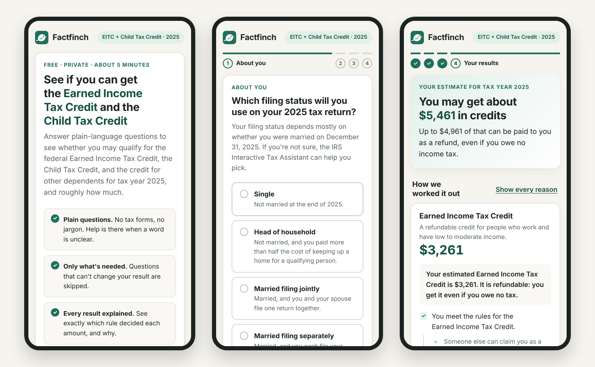

<p align="center">
  
</p>

<p align="center">
  <a href="https://github.com/lobojoel2003/Factfinch/actions/workflows/ci.yml"></a>
  <a href="https://github.com/lobojoel2003/Factfinch/releases"></a>
  <a href="LICENSE"></a>
  
  
</p>

<p align="center">
  <a href="https://lobojoel2003.github.io/Factfinch/"><b>Try the demo</b></a> ·
  <a href="#quick-start">Quick start</a> ·
  <a href="docs/rules-format.md">Write your own rules</a> ·
  <a href="CHANGELOG.md">Changelog</a>
</p>

---

**Factfinch** turns rules written for lawyers into an interview written for people. You describe the rules as data. Factfinch asks only the questions that can still change the answer, works out the results from whatever has been answered so far, and explains every result in plain words.

The first use: an **Earned Income Tax Credit and Child Tax Credit eligibility checker for tax year 2025**.

<p align="center">
  
</p>

## Contents

- [Why Factfinch](#why-factfinch)
- [What you get](#what-you-get)
- [Screenshots](#screenshots)
- [Quick start](#quick-start)
- [How it works](#how-it-works)
- [The EITC and Child Tax Credit rules](#the-eitc-and-child-tax-credit-rules)
- [API reference](#api-reference)
- [Command line](#command-line)
- [Project layout](#project-layout)
- [Development](#development)
- [Versions, builds and releases](#versions-builds-and-releases)
- [Contributing](#contributing)
- [License](#license)

## Why Factfinch

Tax credit and benefit rules are written for lawyers, so people who qualify for money miss out on it. IRS Direct File showed a better way. It turned the tax code into plain-language questions, and a **Fact Graph** worked out what followed from the answers, even from a half-finished return.

Direct File is gone for 2026. Its [repository](https://github.com/IRS-Public/direct-file) has 4.6k stars and 1.4k forks, but it is archived and unmaintained. Its own README calls the Fact Graph "not domain-specific" and useful "as a reference for business rules engine implementations." The original is written in Scala, inside a full tax-filing system.

Factfinch takes that idea out of the archived repo and makes it a small, maintained, general-purpose library. It is a fresh TypeScript implementation, not a port of the Scala code.

## What you get

- **Rules are data.** A rules file is JSON: questions, derived facts, and the sentences that explain them. It's easy to review and diff, and a [JSON Schema](packages/factfinch/schema/factfinch-rules.schema.json) gives your editor autocomplete.
- **Only the questions that matter.** The engine reasons with incomplete answers. Anything that can no longer change a result is never asked. If someone else can claim you as a dependent, the EITC/CTC interview ends after that one question.
- **Every result explained.** Each result comes with a tree of reasons: "Maya is your son or daughter, which is a qualifying relationship", down to the answers given.
- **Tested with known cases.** Rules ship with a cases file. Each case runs as a full interview, so a test proves the amounts _and_ that nothing unneeded was asked.
- **Small and portable.** No runtime dependencies. ESM and CommonJS builds with TypeScript types. Works in the browser, in Node.js and in a terminal (`factfinch ask`).
- **Careful with people's data.** The demo runs entirely in the browser. Nothing is sent anywhere, and "Start over" really clears it.

## Screenshots

One question at a time. The **So far** panel shows each result as soon as it's settled.

<picture>
  <source media="(prefers-color-scheme: dark)" srcset="docs/images/question-dark.png">
  
</picture>

Results lead with the total, then show exactly how each credit was worked out.

<picture>
  <source media="(prefers-color-scheme: dark)" srcset="docs/images/results-dark.png">
  
</picture>

It works the same way on a phone and in dark mode. It's built for keyboard and screen-reader use, and its lint rules include strict accessibility checks.

<p align="center">
  
</p>

## Quick start

Install the package straight from a [GitHub release](https://github.com/lobojoel2003/Factfinch/releases):

```bash
npm install https://github.com/lobojoel2003/Factfinch/releases/download/v0.2.0/factfinch-0.2.0.tgz
```

Once it's published to npm, `npm install factfinch` will work too.

### Run an interview

```ts
import { FactGraph } from "factfinch";
import rules from "factfinch/rules/us-eitc-ctc-2025.json" with { type: "json" };

const graph = FactGraph.load(rules); // validates the rules; throws RulesError if anything is wrong
const session = graph.createSession();

for (let q = session.nextQuestion(); q; q = session.nextQuestion()) {
  // q.prompt, q.help, q.type ("boolean", "dollar", "enum", ...), q.options
  session.set(q.path, await askThePerson(q));
}

for (const result of session.results()) {
  console.log(result.label, result.display); // "Earned Income Tax Credit $3,661"
  console.log(result.explanation); // a tree of plain-language reasons
}
```

### Use it from React

A session notifies subscribers when it changes, so it plugs straight into `useSyncExternalStore`:

```tsx
import { useSyncExternalStore } from "react";
import type { Session } from "factfinch";

export function useSession(session: Session) {
  useSyncExternalStore(
    (onChange) => session.subscribe(onChange),
    () => session.revision,
  );
  return session;
}
```

The [demo app](apps/demo/src) is a complete, tested example.

### Try it in your terminal

```bash
npx factfinch ask node_modules/factfinch/rules/us-eitc-ctc-2025.json
```

After the questions, it prints each result with its reasons (shortened here):

```text
Earned Income Tax Credit: $4,220
  • You meet the rules for the Earned Income Tax Credit.
    • Your earned income (pay from work plus self-employment) is $24,000.
    • Children who count toward your EITC: 1.
      • Leo counts toward your Earned Income Tax Credit.
        • Leo is your qualifying child.
          • Leo is your son or daughter, which is a qualifying relationship.
          • Leo meets the age test.
  • The credit gets smaller once income passes $23,350.
  • For your number of qualifying children, the most the EITC can be is $4,328.
```

## How it works

```mermaid
flowchart LR
    rules["Rules file<br/>(JSON)"] -->|"FactGraph.load<br/>validates"| graph["FactGraph"]
    graph --> session["Session<br/>one person's answers"]
    session -->|"nextQuestion()"| ask["The next question<br/>that can still matter"]
    ask -->|"session.set()"| session
    session -->|"results()"| out["Results with<br/>plain-language reasons"]
```

**Every fact is either known or not known yet.** A known fact has a value. A fact that isn't known yet carries the list of unanswered questions that could settle it. Logic stops as soon as the outcome is settled: an `and` is false the moment one part is false, however many other parts are unanswered. That is what lets the interview skip questions.

```json
"/eitc/eligible": {
  "type": "boolean",
  "derive": { "and": [
    { "fact": "/notADependent" },
    { "fact": "/eitc/ssnRule" },
    { "fact": "/eitc/hasEarnedIncome" },
    { "fact": "/eitc/investmentRule" }
  ]},
  "explain": {
    "true": "You meet the rules for the Earned Income Tax Credit.",
    "false": "You don't meet the rules for the Earned Income Tax Credit."
  }
}
```

**Question order.** `and` and `or` look at their parts from left to right, so the rule author decides which question comes first. Among the questions that could settle something right now, the one declared earliest in the file is asked first. All the questions about one child are asked together, child by child.

**Explanations come from the same evaluation.** Every value records which facts decided it. A false `and` lists every part that failed, because each one needs fixing. A true `or` cites the first part that held, because one reason is enough. Facts without wording of their own are looked through, so the tree only contains sentences a person can read.

The full format is in **[docs/rules-format.md](docs/rules-format.md)**: fact types, collections such as children, all 25 operators, templates and known cases.

## The EITC and Child Tax Credit rules

The bundled rules ([`us-eitc-ctc-2025.json`](packages/factfinch/rules/us-eitc-ctc-2025.json)) estimate these credits for **tax year 2025**:

| Credit                          | What the rules check                                                                                                                                         | Amount                                                                                                                                                       |
| ------------------------------- | ------------------------------------------------------------------------------------------------------------------------------------------------------------ | ------------------------------------------------------------------------------------------------------------------------------------------------------------ |
| **Earned Income Tax Credit**    | Social Security numbers, citizenship or residency, filing status, investment income up to $11,950, age 25–64 without a child, and the qualifying-child tests | IRS EIC table method (Rev. Proc. 2024-40): $50 rows figured at their midpoint, using the smaller of the earned-income and AGI amounts in the phase-out range |
| **Child Tax Credit**            | Dependent child under 17 with an SSN valid for work; you (or your spouse, filing jointly) need one too                                                       | $2,200 per child, reduced by $50 for each $1,000 of income over $200,000 ($400,000 filing jointly)                                                           |
| **Credit for other dependents** | Dependents who don't qualify for the Child Tax Credit, such as a 17-year-old                                                                                 | $500 each                                                                                                                                                    |
| **Refundable part of the CTC**  | —                                                                                                                                                            | Up to $1,700 per child, limited to 15% of earned income over $2,500                                                                                          |

[34 known cases](packages/factfinch/rules/us-eitc-ctc-2025.cases.json) cover the plateau and phase-out ranges, three or more children, filing separately, missing SSNs, students, disabled adult children, self-employment losses, high incomes and more. The expected amounts were worked out independently of the engine.

<details>
<summary><b>Known simplifications</b> (also recorded as <code>notes</code> in the rules file)</summary>

- AGI is estimated as wages + self-employment + investment + other income, without adjustments such as student loan interest.
- Dependents are limited to qualifying children; qualifying relatives aren't covered.
- Children under 18 are assumed not to file joint returns.
- The refundable Child Tax Credit is an upper bound assuming no income tax is owed, and doesn't apply the Social Security tax method for three or more children.
- People who can be claimed as someone else's dependent are treated as ineligible for both credits.

</details>

> [!IMPORTANT]
> This is an estimate for information only. It is not tax advice and not a tax return. Check [IRS.gov](https://www.irs.gov/credits-deductions/individuals/earned-income-tax-credit-eitc) or a free [VITA](https://www.irs.gov/individuals/free-tax-return-preparation-for-qualifying-taxpayers) tax-help site before you file.

## API reference

<details open>
<summary><b>FactGraph</b>: a loaded, validated rules file</summary>

| Call                                                               | What it does                                                               |
| ------------------------------------------------------------------ | -------------------------------------------------------------------------- |
| `FactGraph.load(rules)`                                            | Validate and load a rules file. Throws `RulesError` listing every problem. |
| `validateRules(rules)`                                             | List problems without throwing.                                            |
| `graph.createSession(snapshot?)`                                   | Start an interview, or resume a saved one.                                 |
| `graph.definition(path)` · `graph.paths()` · `graph.isInput(path)` | Inspect the rules.                                                         |
| `graph.sections()`                                                 | Question sections in order, for progress bars.                             |

</details>

<details open>
<summary><b>Session</b>: one person's interview</summary>

| Call                                                                                 | What it does                                                                                  |
| ------------------------------------------------------------------------------------ | --------------------------------------------------------------------------------------------- |
| `nextQuestion()` · `pendingQuestions()`                                              | The next question to ask, or every question that could settle a result right now.             |
| `question(path)`                                                                     | Any question with its text filled in, plus the current answer (for Back buttons).             |
| `set(path, value)` · `unset(path)` · `clear()`                                       | Answer, with type, bounds and options checked; remove an answer; remove all answers.          |
| `addItem(collection, { name })` · `removeItem(collection, id)` · `items(collection)` | Manage collection items such as children.                                                     |
| `batch(fn)`                                                                          | Make several changes as one: listeners hear once, and if `fn` throws, every change is undone. |
| `get(path)` · `value(path)` · `display(path)`                                        | Evaluate any fact, get its value, or get its value in plain words.                            |
| `isComplete()` · `results()` · `explain(path)`                                       | Results with their explanation trees.                                                         |
| `answeredQuestions()` · `relevantAnswers()`                                          | Every answer, or only those the results depend on (for review pages).                         |
| `toJSON()` · `restore(snapshot)`                                                     | Save, and restore all-or-nothing.                                                             |
| `subscribe(fn)` · `revision`                                                         | Change notifications.                                                                         |

</details>

<details>
<summary><b>Helpers</b></summary>

| Call                                                  | What it does                                                         |
| ----------------------------------------------------- | -------------------------------------------------------------------- |
| `runCases(graph, casesFile)` · `runCase(graph, case)` | Run known cases as full interviews, inside any test runner.          |
| `parseAnswer(question, text)`                         | Turn typed text such as `"$1,250"`, `"yes"` or `"2"` into an answer. |
| `validateAnswer(def, value, path)`                    | The check `set` uses.                                                |
| `formatValue` · `formatDollar` · `renderTemplate`     | Formatting and `{{template}}` filling.                               |
| `VERSION` · `BUILD_INFO`                              | Library version, build number and commit.                            |

</details>

Every error is a `FactfinchError` with a stable `code`: `INVALID_ANSWER`, `UNKNOWN_FACT`, `UNKNOWN_ITEM`, `NOT_AN_INPUT`, `INVALID_RULES`, `INVALID_SNAPSHOT`, `EVALUATION_ERROR` or `CYCLE`.

## Command line

| Command                                              | What it does                                                                          |
| ---------------------------------------------------- | ------------------------------------------------------------------------------------- |
| `factfinch validate <rules.json> [--json]`           | Check a rules file and report each problem with its location.                         |
| `factfinch test <rules.json> <cases.json> [--json]`  | Run known cases. Exits with code 1 if any fail, so it works in CI.                    |
| `factfinch ask <rules.json>`                         | Run the interview in a terminal. Answers can also be piped in.                        |
| `factfinch run <rules.json> <answers.json> [--json]` | Results and reasons for saved answers, such as the demo's "Download my answers" file. |
| `factfinch --version`                                | Version, build number and commit, e.g. `0.2.0+build.42 (1a2b3c4d5e6f)`.               |

## Project layout

```text
packages/factfinch/          The library and CLI (npm package "factfinch")
├── src/                     Engine: graph, session, evaluate, validate, explain, cli
├── rules/                   us-eitc-ctc-2025.json and its .cases.json
├── schema/                  JSON Schemas for rules and cases files
└── test/                    Unit tests, CLI tests, and every known case
apps/demo/                   React demo, deployed to GitHub Pages
├── src/state/               Interview state, browser history, saved progress
├── src/components/          Question card, children editor, results, reasons tree
└── test/                    Tests that drive the app the way a person would
docs/                        Rules format, release guide, README images
scripts/                     Build stamping, versioning, packaging, screenshots
```

## Development

You need Node.js 20 or newer.

```bash
npm ci
```

```bash
npm run dev
```

That starts the demo at http://localhost:5173. It reads the library's source directly, so changes to the engine appear immediately.

| Script                                                  | What it does                                                                        |
| ------------------------------------------------------- | ----------------------------------------------------------------------------------- |
| `npm test`                                              | Library tests, every known case, and the demo tests                                 |
| `npm run test:coverage`                                 | The same, with coverage thresholds enforced                                         |
| `npm run lint` · `npm run format` · `npm run typecheck` | ESLint (including accessibility rules), Prettier, TypeScript                        |
| `npm run build`                                         | Library (ESM, CJS, types, CLI) and the demo                                         |
| `npm run validate:rules`                                | Validate the bundled rules and run their cases through the CLI                      |
| `npm run screenshots`                                   | Rebuild the README images from the real demo (needs Playwright; ffmpeg for the GIF) |
| `npm run ci`                                            | Everything CI runs                                                                  |

## Versions, builds and releases

- **Versions** follow [Semantic Versioning](https://semver.org). Every package in the repo shares one version, set with `npm run version:set -- 0.3.0`, and releases are tagged `vX.Y.Z`.
- **Build numbers**: each CI build is stamped with its run number and commit. You can see them in `npx factfinch --version`, `BUILD_INFO` and the demo's footer.
- **Rules versions** are separate (for example `2025.2.0`), so a rules correction can ship without an engine change.
- **Releases**: pushing a tag, or running the Release workflow by hand, runs the full checks and then publishes a GitHub release with the npm tarball, the built demo, the rules files and SHA-256 checksums. It also publishes to npm when an `NPM_TOKEN` secret is set. See [docs/releasing.md](docs/releasing.md).

| Workflow                                   | When it runs                | What it does                                                                          |
| ------------------------------------------ | --------------------------- | ------------------------------------------------------------------------------------- |
| [CI](.github/workflows/ci.yml)             | Every push and pull request | Format, lint, typecheck and tests with coverage on Node 20, 22 and 24; build; package |
| [Deploy demo](.github/workflows/pages.yml) | Pushes to `main`            | Test, build and deploy the demo to GitHub Pages                                       |
| [Release](.github/workflows/release.yml)   | Tags `v*.*.*`, or by hand   | Check the tag matches the version, run all checks, publish the release                |

## Contributing

Contributions are welcome, especially new rules files and known cases. See [CONTRIBUTING.md](CONTRIBUTING.md). To report a security problem, see [SECURITY.md](SECURITY.md).

## License

[Apache License 2.0](LICENSE). Factfinch is an independent project inspired by the IRS Direct File Fact Graph. It is not affiliated with or endorsed by the IRS.
